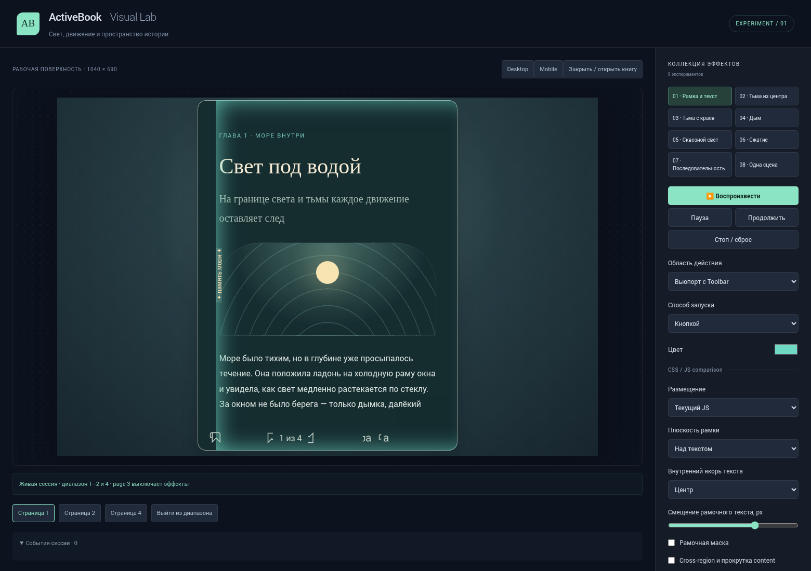
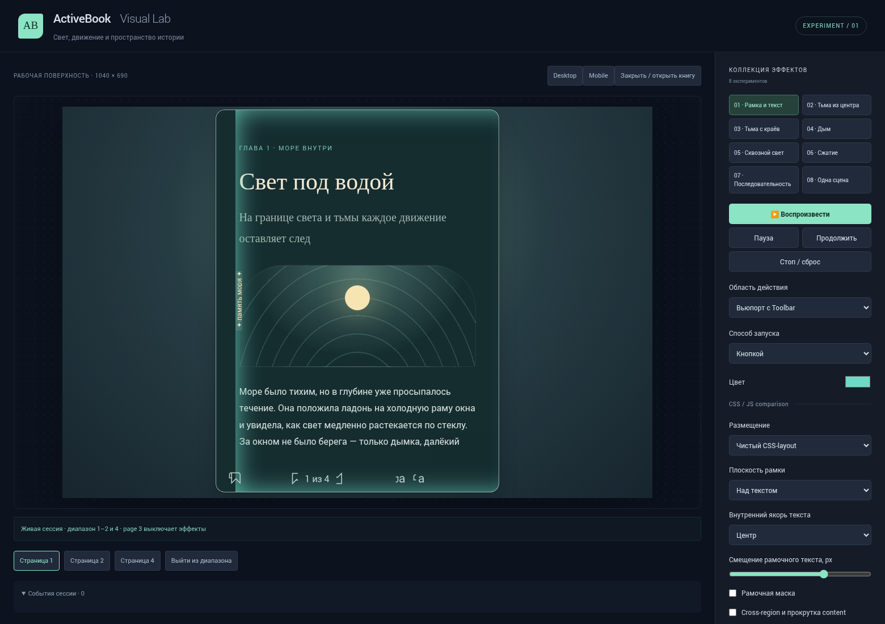
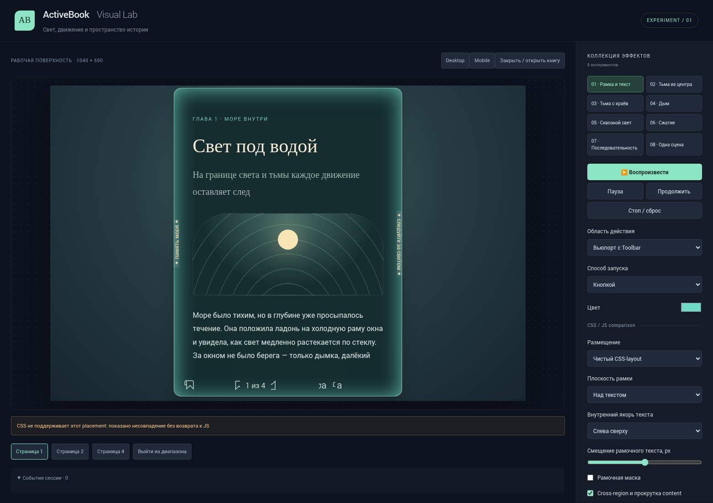
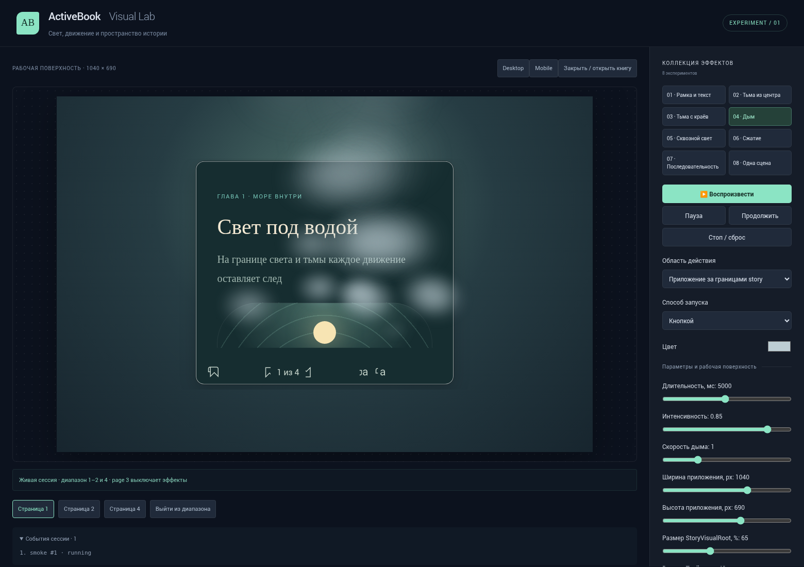
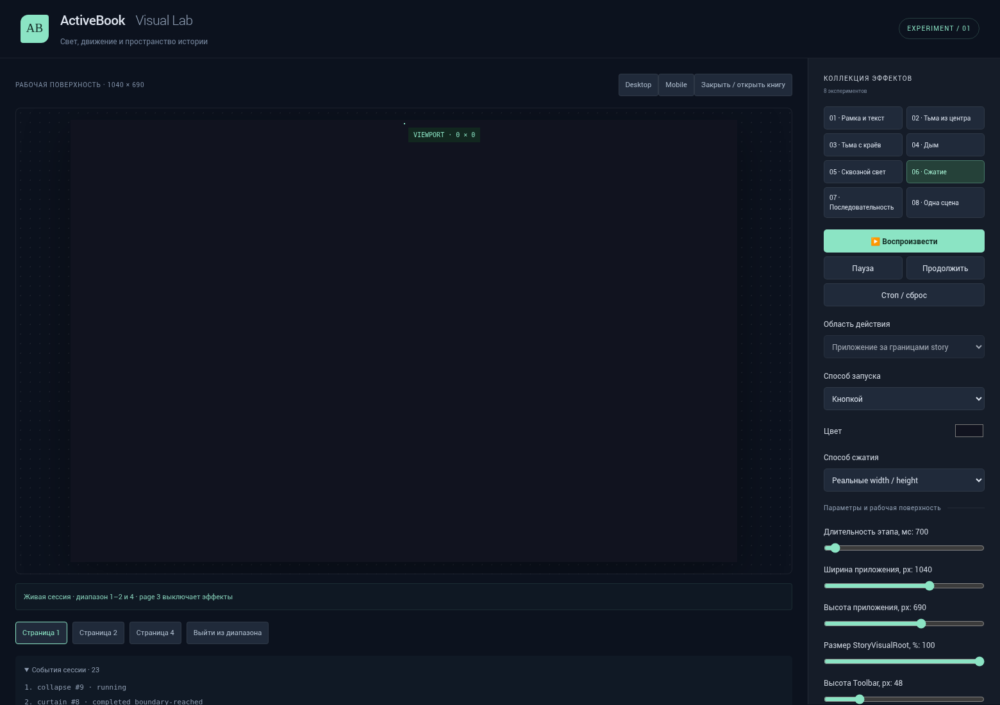

# Visual Lab: работающие эксперименты

Экспериментальная ветка: `experiment/visual-effects-playground`. Основа — актуальный `main` `9d91625`, с изменениями и ручным рефакторингом PR #27. Согласованная ветка типов добавляет регион `application`; редактор принимает его в compiler и использует собранное ядро **0.0.45**. Демонстрационные renderers находятся в `tests/visualPlayground`, а не в production-каталоге.

Ветки: [ядро](https://github.com/KrimsonKing1337/active-book-core/tree/experiment/visual-effects-playground), [типы](https://github.com/KrimsonKing1337/active-book-types/tree/experiment/visual-effects-playground), [редактор](https://github.com/KrimsonKing1337/active-book-editor/tree/experiment/visual-effects-playground).

Draft PR для ручного просмотра: [ядро #28](https://github.com/KrimsonKing1337/active-book-core/pull/28), [типы #6](https://github.com/KrimsonKing1337/active-book-types/pull/6), [редактор #51](https://github.com/KrimsonKing1337/active-book-editor/pull/51). Merge не выполнялся.

## Запуск

Репозитории `active-book-types` и `active-book-core` должны лежать рядом и быть на экспериментальных ветках. После обычной установки зависимостей (`npm ci` в обоих репозиториях) в каталоге ядра выполните:

```sh
npm run dev:visual-lab
```

Открывается [http://localhost:4175/tests/visualPlayground/](http://localhost:4175/tests/visualPlayground/). Vite может выбрать следующий порт, если 4175 занят; используйте напечатанный адрес. Для reader-контекста добавьте `?mode=reader`. Сборка ядра для запуска лаборатории не требуется: она использует реальные компоненты и session из исходников.

Панель справа расположена вне приложения произведения. Эффекты её не накрывают. Панель прокручивается отдельно; размеры рабочей поверхности можно менять ползунками, кнопками Desktop/Mobile и размером окна. Mobile меняет размер embed и применяет container queries; это не эмулятор устройства.

Проверки:

```sh
npm run typecheck
npm run typecheck:test
npm run test:visual-lab
npm run test:browser
```

На Linux с системным Chromium: `PLAYWRIGHT_CHROMIUM_EXECUTABLE_PATH=/usr/bin/chromium npm run test:visual-lab`. Unit-проверки: `npx jest --runInBand`; упаковочные проверки: `npm run test:scss-alias`. Сценарии генерируют материалы в игнорируемый `tests/visualPlayground/artifacts/`; это не golden images. Ни один старый эталон не обновлялся.

### Диагностическая прозрачность

В `.Controls` есть ползунок **«Прозрачность эффекта»**: 0% оставляет эффект непрозрачным, 100% делает его полностью прозрачным. При 65% прозрачности видимая непрозрачность равна 35%. Это отдельный параметр `opacity`, который умножается на художественную интенсивность или анимационное затухание эффекта; существующие сценарии с принудительным `intensity: 1` тоже можно сделать полупрозрачными.

Изменение ползунка обновляет параметры существующей регистрации и не предназначено для изменения длительности анимации или её запуска. Начальное значение — 0% прозрачности, чтобы сохранить исходный вид демонстраций и пиксельные проверки.

## Что можно попробовать

| Пресет | Действия автора и видимый результат |
|---|---|
| **Рамка и текст** | Выберите JS/CSS/гибрид, область, плоскость и рамочную маску. Поменяйте внутренний якорь/смещение. Используются настоящие FrameRenderer, FrameElement, FrameShadow и FrameText; кнопка запуска включает pulse/scroll |
| **Тьма из центра** | Выберите область, рост / сужение / раскрытие из центра, длительность, цвет, интенсивность и точку возникновения; нажмите «Воспроизвести». Это CSS circle/маска, без Canvas |
| **Тьма с краёв** | Выберите длительность и цвет. Подложка заполняет приложение, но непрозрачный viewport естественно скрывает её, включая правильное поведение скруглённых углов. Момент остановки у границы не вычисляется |
| **Дым** | Выберите область, интенсивность, независимую скорость, цвет и длительность. Несколько CSS-элементов поднимаются от низа narrativeFrame, расходятся и исчезают. При application visibility дым выходит за уменьшенную story |
| **Сквозной свет** | Выберите application scope, длительность и один renderer / три эффекта. Свет начинается у нижней границы narrativeFrame, проходит Toolbar и свободное пространство |
| **Сжатие** | Выберите scale или реальные width/height. Один запуск выполняет затемнение приложения → сжатие до нуля → восстановление → раскрытие тьмы |
| **Последовательность** | Один элемент управления запускает narrative darkness → milestone → внешнюю тьму → сжатие → восстановление и раскрытие. Не нужно создавать события или JSON вручную |
| **Одна сцена** | Аналогичный художественный результат одним renderer и одним clock, без цепочки run waits. Позволяет сравнить сложность решения с предыдущим пресетом |

Чекбокс **«Зациклить»** повторяет демонстрацию после её полного завершения, включая составные сцены целиком. Выключение чекбокса позволяет текущему воспроизведению закончиться; «Стоп / сброс» прерывает цикл сразу. Пауза блокирует переход к следующей итерации до продолжения.

«Пауза» сохраняет кадр и lease; «Продолжить» возобновляет тот же run. «Воспроизвести» начинает новый запуск, «Стоп / сброс» отменяет сцену и восстанавливает layout. Вариант запуска «При переходе страницы» не реагирует на обычное редактирование параметров. У составных пресетов длительность явно подписана как длительность **этапа**; у «Одной сцены» это длительность всей сцены.

Диапазон эффектов — страницы 1–2 и отдельно 4. Переход 1→4 сохраняет экземпляр. Кнопка выхода ведёт на страницу 3 и размонтирует эффекты; возврат создаёт новые. «Закрыть / открыть книгу» проверяет detach и повторное открытие.

При физических сценах над тьмой виден пунктирный контур VIEWPORT с размерами. Это **host-диагностика** на защищённом feedback layer, позволяющая наблюдать сжатие под непрозрачной тьмой; она не является частью художественного эффекта и не управляет layout.

## Результат CSS / JS / гибрид

Здесь CSS означает эксперимент размещения поверх общих SCSS-правил, JS — прежние `resolvePlacement` / `resolveVisualSurface`, гибрид — явный выбор CSS для поддержанного fill и JS для custom. Внешний host и физический actuator — отдельные возможности: способ размещения сам их не создаёт.

| Возможность | CSS | Текущий JS | Гибрид |
|---|---|---|---|
| Простое заполнение региона | Совпадает: surface и clip одинаковы во всех 5 размерных случаях | Контрольный результат | Выбирает CSS для поддержанного fill |
| Адаптивная рамка | Совпадает при desktop/mobile, Toolbar 48/70/92px и без Toolbar; маски и углы проверены | Совпадает с настоящими DOM-регионами | Тот же CSS-path для стандартных случаев |
| Независимый anchor | Внутренние якоря FrameElement работают; независимый **placement anchor** не поддержан | narrativeContent coordinates + storyViewport anchor остаётся неподвижным при scroll | Явно выбирает JS и сохраняет тот же результат |
| Cross-region размещение | Произвольный fill не поддержан: видны неверные bounds и предупреждение, никакого скрытого JS fallback | Размер 80% content × 300px, offset 20/50px, другая visibility работают | JS-path виден через `data-surface-layout` и подписан в выборе режима |
| Прокрутка | Стандартный viewport fill неподвижен; перемещение narrativeContent не воспроизводится | При scroll 180px поверхность переместилась ровно на −180px | Для content использует JS; для обычного fill остаётся CSS |
| Выход за StoryVisualRoot | CSS-fill остаётся внутри story; самостоятельный CSS external placement не реализован | Внутренний JS также clipped; тот же resolver, направленный в application host, заполняет внешнюю оболочку | Существующая геометрия + постоянные внешние hosts работают при storySize=65–70% |
| Физическое изменение layout | CSS width/height действительно достигают 0×0; один CSS-fill не управляет чужими элементами | Сам resolver измеряет, а не изменяет layout | Host lease + JS clock + CSS properties: оба способа сжатия, отмена и удаление проверены |

Это рабочая альтернатива, а не `inset: 0` поверх прежних наружных пиксельных стилей. CSS-path не вызывает `resolveVisualSurface` для собственного размещения: наружный layout строят flex и общие mixins из `src/styles/_storyLayout.scss`. Surface и clipping получают размеры от CSS-контейнеров. Исходный PageWrapper использует те же mixins; правило Toolbar также общее.

Прямые результаты Chromium, CSS и JS одинаковы:

| Embed / Toolbar / область | Surface JS = CSS | Clip JS = CSS |
|---|---|---|
| 1040×690 / 48px / storyViewport | 500×675 | 500×675 |
| 820×560 / 92px / narrativeFrame | 500×429.609375 | 500×429.609375 |
| 1040×720 / без Toolbar / narrativeFrame + frame mask | 500×705 | 500×705 |
| 390×740 / 70px / storyViewport + frame mask | 390×740 | 390×646.609375 |
| 1040×690 / 48px / storyViewport + frame mask | 500×675 | 500×603.609375 |

Точные значения, включая origins: [measurements.json](visual-playground/measurements.json). Последняя mobile-цифра зависит от viewport, которым разрешается `clamp()`; сравнение выполняется в одном и том же browser viewport, а не между разными машинами.

**Измерения полностью не исчезли:** одна существующая geometry subscription остаётся для renderer dimensions, custom placement, внешних anchors и диагностики. Instrumentation проверяет ровно один активный observer регионов и его освобождение при закрытии. Дополнительного CSS-измерителя нет. Переключение JS↔CSS также сохраняет renderer token: структура Surface стабильна, меняются стили, а не React-parent.

## Что проверено на внешних слоях

`BookApplicationSurface` — необязательная постоянная embed boundary. Story сохраняет overflow hidden и isolation. Плоскости рендерятся в выделенные постоянные DOM-hosts этой оболочки через portal **из прежнего React/session дерева**. В body ничего не выводится.

```text
BookApplicationSurface
├─ underStory                  z=0
├─ обычная story-оболочка       z=1
│  └─ StoryVisualRoot + прежние внутренние плоскости
├─ aboveStory                  z=2
├─ host feedback               z=3
└─ editor selection            z=4
```

`useVisualEffectSurfaces` и `connectHost` остаются единственными. Runtime definition metadata (`surfaceHost`, `surfaceLayout`) выбирает место рисования; это не авторский z-index и не новая сериализованная регистрация. Application region добавлен в общий контракт. Координаты переводятся сменой origin, без отдельного layout resolver.

Проверены покрытие внешнего прямоугольника при уменьшенной story, отличающийся пример с прежним регионом story, дым за clip boundary, подложка под непрозрачным viewport и pixel priority system feedback над внешней тьмой. Декоративные hosts inert и не принимают pointer events. Панель эксперимента находится снаружи. Инверсия на application-host охватывает внутренние и внешние слои вместе; без application-host остаётся прежний путь.

## Физические воздействия и координация

Один target — storyViewport. `createViewportLayoutHost` владеет выделенной CSS custom property и data attribute. Lease эксклюзивна: второй владелец получает ошибку, а не молча перезаписывает transform. Release идемпотентен; stale update не меняет новый target. При замене страницы target перепривязывается, при отмене/удалении восстанавливается актуальный baseline, без сохранения и перезаписи cssText.

| Проверенное состояние | Визуальные bounds | clientWidth/clientHeight |
|---|---|---|
| До воздействия | 500×675 | 500×675 |
| scale=0 | 0×0 | **500×675**, layout footprint сохранён |
| width/height factor=0 | 0×0 | **0×0**, текст и flex пересчитываются |
| После обоих вариантов | 500×675 | 500×675 |

Фактор рассчитывается от времени и baseline, а не повторным умножением измеренной ширины. Бесконечного measurement/write loop нет. Во время физического движения host явно инвалидирует существующую geometry subscription; она объединяет чтения в rAF. Для своего известного uniform scale client dimensions и frame insets переводятся в визуальные размеры. Поддержки произвольных transform matrices это не добавляет.

`session.runs` хранит только текущий run каждого эффекта: number, status, milestones. Started представлен переходом в running; pause/resume сохраняют number, complete/cancel — терминальные состояния. UI показывает журнал редких переходов. Покадровый progress остаётся в renderer и не попадает в authored params/registration snapshots.

Составной preset вызывает playback и ждёт **конкретный run handle**, milestone либо completion. Поздняя подписка читает сохранённое состояние. Новый запуск получает новый number, старый reporter ничего не меняет. Удаление регистрации отменяет waits и удаляет её run-state; destroy очищает подписки. StrictMode не запускает animation command при mount: команды идут от действий автора или явного page trigger.

«Одна сцена» использует один renderer/clock и тот же host layout lease. Для заранее известной художественной композиции это проще цепочки эффектов. Отдельный runner полезен, когда действительно нужны независимые renderers и именованная контрольная точка. Универсальный сценарный язык и граф зависимостей не добавлены.

## Материалы

Скриншоты созданы настоящим Chromium. Существующие screenshot baselines не менялись.

| JS | CSS |
|---|---|
|  |  |







Дополнительно: [underlay и углы](visual-playground/05-underlay-corners.png), [один сквозной renderer](visual-playground/07-single-wave.png), [три поверхности](visual-playground/08-composed-wave.png), [сжатие scale](visual-playground/09-collapse-scale.png).

## Проверки и ограничения

- Baseline до изменений: ядро 47 unit + 26 browser, все прошли; editor 63 unit прошли, 3 browser tests упали из-за старого locator. Исправление locators — отдельный коммит; затем editor browser 12/12.
- Гонка stop в CounterRenderer fixture устранена синхронным playback guard: queued interval мог выполнить update до passive cleanup. Строгое ожидание ticks=0 сохранено, добавлены ожидание старого timer task и проверка activeTimers=0. Production lifecycle не подменялся.
- Итог: source и fixture TypeScript, types NodeNext/Bundler, core 51 Jest tests и 8 SCSS packaging tests проходят. **35/35** проверок Chromium (с учётом родительских subtests) прошли; новые scenarios проверяют geometry, masks/corners, настоящий animation object и renderer identity, disjoint range, внешний clipping, feedback pixels, оба физических режима, pause/resume, отмену, удаление регистрации, late milestone, повтор, StrictMode, очистку подписок/observer и reader mode.
- Редактор с ядром 0.0.45: workspace/test TypeScript, 64 unit, 4 component, 12 browser, production build и editor→production-book E2E проходят. Новый регион сохраняется compiler без изменения авторских данных. Новая панель пресетов в production editor не интегрирована.
- ESLint для изменённых TypeScript и fixture проходит без errors; остаются предупреждения max-lines в больших модулях и существующее предупреждение зависимости dispatch в PageWrapper. Stylelint изменённых SCSS проходит. Vite сохраняет предупреждения о динамическом импорте страниц и размере production bundle.

Ограничения прототипа:

1. Чистый CSS-path поддерживает fills storyViewport/narrativeFrame и frame visibility. Произвольные placement anchors, narrativeContent positioning и shape masks намеренно не поддержаны; показан явный отказ. Гибрид использует JS. Поддержка стандартных fills сама по себе не доказывает ускорение: CPU/GPU benchmark не проводился.
2. CSS-сравнение использует общие правила Toolbar и общий параметр его высоты. Произвольный сторонний Toolbar с неизвестной intrinsic height, загрузочные состояния и другие структуры layout не объявляются поддержанными CSS-path.
3. Физика ограничена одним target и одним владельцем, scale или width/height. Нет rotation/skew, свободных DOM refs, композиции нескольких leases, обратного проигрывания или универсального timeline. Transform создаёт stacking context; эксперимент проверен под внешней тьмой, а не как универсальная деформация всех существующих плоскостей.
4. `boundary-reached` — checkpoint демонстрационной фазы на 55% её clock, **не** доказательство геометрического покрытия региона на 100%. У эффектов с настоящим геометрическим milestone семантика должна определяться конкретной формой. Completed означает конец выбранной анимации.
5. Вариант из трёх сквозных эффектов специально показывает швы разных поверхностей и разных радиусов. Для одной волны один renderer проще и визуально непрерывнее; отдельный Canvas для этого не потребовался.
6. Проверено в Linux Chromium. Windows, WebKit, Firefox и реальные мобильные устройства не проверены. Контракты внешних hosts экспериментальные и не публикуют демонстрационные эффекты как готовую production-библиотеку.

Рекомендация после прототипов: сохранить JS для общего placement и независимой visibility. CSS fills можно оставить как ограниченный opt-in, поскольку они работают без remount и второго измерителя; превращать их в замену всей геометрии оснований нет. Сохранить bounded application host и маленький lease API. Простые художественные композиции предлагать автору одним preset/renderer; session run checkpoints использовать там, где несколько эффектов действительно должны оставаться независимыми.
